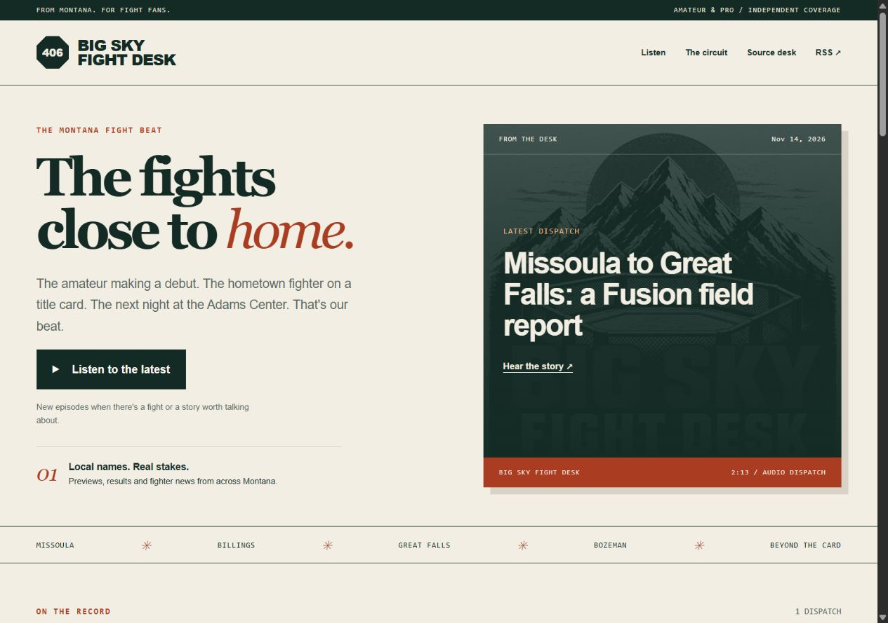

# Big Sky Fight Desk

Real Montana MMA. A short podcast with the sources to back it up.

[Listen to the show](https://www.taylordorsett.com/big-sky-fight-desk/) · [RSS feed](https://www.taylordorsett.com/big-sky-fight-desk/feed.xml)



The studio runs on your computer. Give it a topic and it researches real events, drafts a script, checks the evidence and makes an MP3 and a PNG cover. Read the script and sources, listen to the result, then export an episode for the public page.

The public site is just files. Visitors can listen and read without calling a model or spending your API credits.

## Start the studio

You need Python 3.12 or newer and an OpenAI API key with credits. Image generation may require organization verification and access to `gpt-image-2`.

On Windows, run this once from the project folder:

```powershell
./setup.ps1
```

Put your key in the local `.env` file. Never commit it or paste it into the public website.

```text
OPENAI_API_KEY=your_key_here
DAILY_ALLOWANCE=2.00
MONTHLY_ALLOWANCE=10.00
PUBLIC_URL=https://www.taylordorsett.com/big-sky-fight-desk
```

Open `start-studio.cmd`, then visit [the local studio](http://127.0.0.1:8765). Leave its terminal open while generating. Close it to stop the studio.

On macOS or Linux:

```sh
python3 -m venv .venv
. .venv/bin/activate
python -m pip install -r requirements.txt
cp .env.example .env
# Add your key to .env.
python -m desk studio
```

## Make an episode

1. Enter a topic, research date and target length. Specific events work better than broad requests.
2. Choose Research & draft. The studio saves research, facts and the script as it goes.
3. Read the evidence check. Use Revise from feedback or edit the script yourself if it needs work. Saving edits clears approval and invalidates old media.
4. Generate audio & cover after a passing check. Choose Review the audio for an automated check of the actual MP3. Then listen yourself and inspect the PNG.
5. Read the linked sources, approve the episode and export it. The public preview updates on your computer.
6. Publish the exported files through a separate branch and pull request. The studio does not push to GitHub.

The length is a target. A short evidence set should produce a short episode. It should never invent details to fill time.

## What gets saved

Each private episode lives in `.local/episodes/<id>/` with `episode.json`, `transcript.txt`, `episode.mp3` and `cover.png`. Research excerpts, review results and step timestamps stay private. `.local` and `.env` are ignored by Git.

Export copies only approved public material to `public/episodes/<id>/` and updates `public/episodes.json`. It includes the script, source links, reporting date and finished media. Source page excerpts and internal logs are not exported.

## How it works

This is a bounded agent workflow. Code controls the order of research, evidence extraction, writing, review and media generation. The research model uses a web search tool. It does not get a shell or permission to publish.

| Step | Tool or model | Purpose |
| --- | --- | --- |
| Research | GPT 5 mini and web search | Find relevant pages on selected source domains |
| Source reading | Bounded HTML fetches | Read the pages behind the citations |
| Facts and script | GPT 5 mini | Turn the excerpts into a sourced radio script |
| Evidence check | GPT 4.1 | Check the proposed script against its actual sources |
| Voice | GPT 4o mini TTS, Cedar | Make the MP3 with a disclosed AI voice |
| Audio check | GPT Audio 1.5 | Review the recording for clarity, pacing and natural delivery |
| Cover | GPT Image 2 | Make original illustrated artwork |
| Publishing | Static files and GitHub Pages | Serve approved episodes without a paid backend |

These are existing models. We did not train or fine tune them. The project supplies prompts, live source material and checks around their outputs. See [the code guide](docs/code-guide.md) for details.

The spoken show opens on the news. AI voice disclosure stays on the listening page. Audio review is automated and subjective, so it does not replace listening yourself. A passing check is tied to the exact script and MP3.

## Coverage and sources

Episodes follow actual fight announcements, results and news about Montana fighters, amateur and pro. There is no weekly quota. The [source directory](public/sources.json) feeds both studio research and the public source desk. The [editorial plan](docs/editorial-plan.md) tracks archive leads and missing evidence.

## Reporting rules

Start with Fusion Fight League and include other promoters when there is a sourced Montana connection. Do not mistake an old event listing for a current promotion schedule. Label MMA, boxing, kickboxing and bare knuckle separately.

A search summary is a lead, not proof. Facts need a retrieved source URL and readable source text. Results should be attributed. A listing is not a guarantee that a card will happen. If sources disagree or details are missing, say what could not be confirmed.

The model review can still miss mistakes. Human review is part of publication. Covers are illustrations, not photographs of the reported fights. The voice is AI generated and does not imitate a real fighter or broadcaster.

## Spending limits

The default app allowance is $2 per Denver calendar day and $10 per month. Reservations are saved in SQLite before each paid request. A normal first attempt reserves $0.44 for research through review and $0.45 for media. A revision plus another check reserves $0.16. A separate script check reserves $0.08. An audio review reserves $1.10. A complete first attempt including audio review reserves $1.99.

These are conservative activity allowances, not an exact OpenAI bill or a guaranteed dollar cap. Provider prices can change. Check your OpenAI usage dashboard and account limits too. Failed or interrupted requests keep their reservations because they may have reached the provider. Automatic SDK retries are disabled. Completed steps are reused when resuming.

Use one studio process at a time. Do not run the CLI against an episode while the studio is generating it. Back up `.local` to preserve private work and allowance history. Deleting it resets that local history.

## Publish

Export in the studio first. Then create a branch, commit the changed public files and open a pull request with screenshots. Inspect the public preview in a browser before pushing. Merge after checks pass.

The Pages workflow runs tests, builds the static site and deploys `dist/`. GitHub Pages must be set to GitHub Actions in repository settings. No API key is needed in GitHub Actions.

```sh
python -m desk build
```

The RSS feed supports direct subscription by URL. The show is not automatically submitted to Spotify, Apple Podcasts or other directories.

## Tests

```sh
python -m pip install -r requirements-dev.txt
python -m pytest -q
python -m desk build
node --check web/studio/studio.js
node --check web/shared/listen.js
```

Tests use fake providers and make no paid requests. Live validation and browser observations are recorded in [the release checks](docs/validation.md).

## If something stops

If research cannot read two sources, narrow the topic to an event with accessible venue or local reporting pages. The app does not bypass blocked pages.

If OpenAI rejects a key or model, fix account access and restart the studio. For image access errors, check organization verification. Resume media to reuse any completed MP3 rather than paying for it again.

If the allowance runs out, the episode stays saved. Resume after it resets or intentionally change your local allowance. An incomplete episode cannot be exported as finished.
